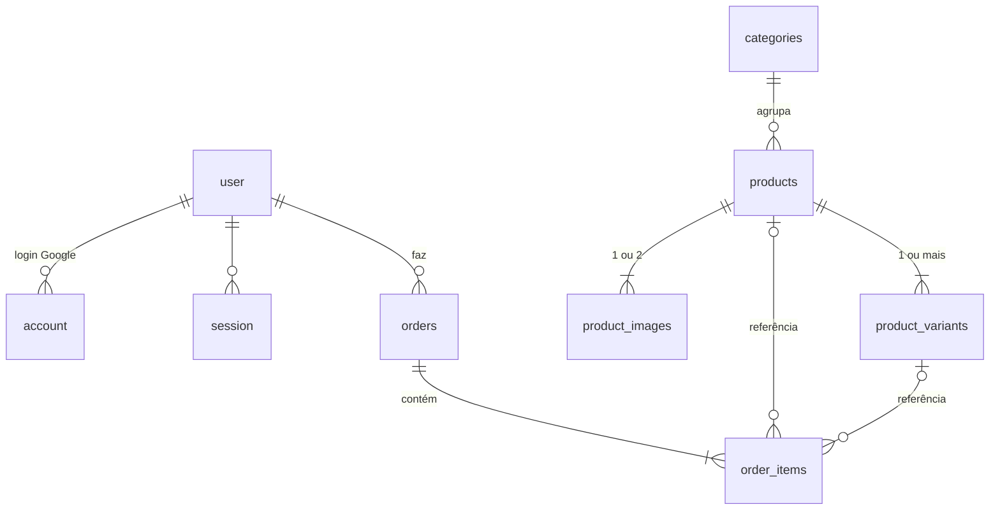

# Modelagem do Banco · Loja DEA (MVP)

Proposta de modelagem do banco de dados da lojinha. **Ainda não implementada.**

## 1. Decisões do MVP

| Tema | Decisão |
| :--- | :--- |
| Banco | PostgreSQL no **Railway** |
| Login | **Apenas Google**. Obrigatório para fechar pedido; o carrinho continua anônimo no `localStorage` |
| Dados do cliente | O que vem do Google (nome, e-mail, foto) + **telefone**, pedido uma única vez no primeiro checkout |
| Catálogo | Sai do `products.json` e vai para o banco. O JSON vira o **seed** |
| Estoque | **Quantidade por tamanho**, atualizada **manualmente no banco**. O site não desconta sozinho |
| Pagamento | **Fora do sistema**. Combinado no encontro de quinta-feira |
| Fechamento | Pedido gravado no banco e mensagem no WhatsApp com o **código do pedido** |
| "Novo lote" | Só um selo (`badge`), sem tabela de lotes |
| Painel de admin | Fora do MVP. Há uma coluna `role` para uso futuro |
| Imagens | `url` livre (`/images/...` ou `https://...`). Provavelmente um bucket no futuro, sem mudança no schema |

## 2. Diagrama

## 3. Tabelas

Convenções:
- Dinheiro sempre em **centavos** (`integer`).
- Datas em `timestamptz`.
- Nomes de colunas em `snake_case`.

### Autenticação

As tabelas `user`, `session`, `account` e `verification` seguem o formato da biblioteca de autenticação. A sugestão é o **Better Auth**, que é estável e suporta Next 16 e Drizzle. O Auth.js v5 ainda está em beta.

**`user`**

| Coluna | Tipo | Notas |
| :--- | :--- | :--- |
| `id` | `text` PK | Gerado pela lib de auth |
| `name` | `text` | Vem do Google |
| `email` | `text` único | Vem do Google |
| `email_verified` | `boolean` | Exigido pela lib |
| `image` | `text` null | Foto do Google |
| `phone` | `text` null | Formato E.164 (`+5511999998888`). Nulo até o 1º pedido |
| `role` | enum `customer` \| `admin` | Padrão `customer`. Admins definidos por `ADMIN_EMAILS` no primeiro login |
| `created_at`, `updated_at` | `timestamptz` | |

**`account`**

Vínculo com o Google. Campos principais: `user_id`, `provider_id` (`google`), `account_id`, tokens opcionais. Tem índice único em (`provider_id`, `account_id`).

**`session`** e **`verification`**

Controladas pela lib de auth. A `session` guarda `token`, `user_id`, `expires_at`, IP e user agent.

### Catálogo

**`categories`**

| Coluna | Tipo | Notas |
| :--- | :--- | :--- |
| `id` | `text` PK | Estável, vindo do seed (ex.: `camisetas`) |
| `slug` | `text` único | |
| `name` | `text` | |
| `sort_order` | `int` | |

**`products`**

| Coluna | Tipo | Notas |
| :--- | :--- | :--- |
| `id` | `text` PK | Estável, vindo do seed. Também é usado pelo carrinho no navegador |
| `slug` | `text` único | |
| `name`, `description` | `text` | |
| `category_id` | FK → `categories` | |
| `price_cents` | `int` ≥ 0 | |
| `compare_at_cents` | `int` null | Preço "de", para promoções |
| `badge` | `text` null | "Novo lote", "Promoção"… |
| `featured`, `active` | `boolean` | Produto inativo some do site, mas os pedidos antigos continuam válidos |
| `sort_order` | `int` | |
| `highlights` | enum[] | `novidades`, `promocoes`, `mais-pedidos` (array em vez de tabela extra) |
| `created_at`, `updated_at` | `timestamptz` | |

**`product_images`** (1 ou 2 por produto)

| Coluna | Tipo | Notas |
| :--- | :--- | :--- |
| `id` | `serial` PK | |
| `product_id` | FK → `products` (cascade) | |
| `url` | `text` | Caminho local ou URL completa |
| `alt` | `text` | |
| `kind` | enum `product` \| `detail` | |
| `position` | `int` | Único por produto |

**`product_variants`** (o estoque fica aqui)

| Coluna | Tipo | Notas |
| :--- | :--- | :--- |
| `id` | `text` PK | Estável, vindo do seed (ex.: `camiseta-sagrado-coracao-m`) |
| `product_id` | FK → `products` (cascade) | |
| `label` | `text` | `P`, `M`, `G`… ou **`Único`** para produto sem tamanho |
| `stock` | `int` ≥ 0 | **Editado à mão.** `0` = esgotado |
| `sort_order` | `int` | |

Tem índice único em (`product_id`, `label`).

### Pedidos

**`orders`**

| Coluna | Tipo | Notas |
| :--- | :--- | :--- |
| `id` | `uuid` PK | |
| `number` | `serial` único | Exibido como **`DEA-0042`** na mensagem do WhatsApp |
| `user_id` | FK → `user` | |
| `contact_phone` | `text` | Cópia do telefone no momento do pedido |
| `total_cents` | `int` | Calculado no servidor, nunca vindo do navegador |
| `status` | enum `pending` \| `done` \| `canceled` | Padrão `pending`. Atualizado à mão, opcional |
| `created_at`, `updated_at` | `timestamptz` | |

**`order_items`** (snapshot do momento da compra)

| Coluna | Tipo | Notas |
| :--- | :--- | :--- |
| `id` | `serial` PK | |
| `order_id` | FK → `orders` (cascade) | |
| `product_id` | FK → `products` null (set null) | Só referência |
| `variant_id` | FK → `product_variants` null (set null) | Só referência |
| `product_name` | `text` | **Cópia** do nome |
| `variant_label` | `text` | **Cópia** do tamanho |
| `unit_price_cents` | `int` | **Cópia** do preço |
| `quantity` | `int` > 0 | |

Se o preço ou o nome de um produto mudar depois, os pedidos antigos continuam mostrando o que foi comprado.
